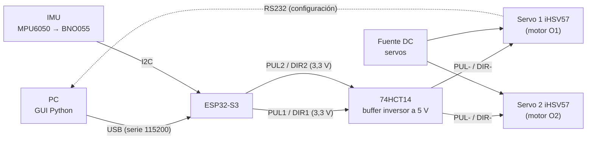

# 02 · Hardware

## Diagrama general

## Componentes

| Componente | Modelo | Cant. | Función |
|---|---|---|---|
| Servomotor AC integrado | JMC **iHSV57-30-18-36** | 2 | Actuadores de los eslabones proximales |
| Microcontrolador | ESP32-S3 (Arduino-ESP32 core) | 1 | Generación de trayectoria y pulsos, seguridad, telemetría |
| Buffer | 74HCT14 (hex inversor Schmitt) | 1 | Adapta 3,3 V → 5 V, invierte el pulso y limpia flancos |
| IMU (etapa 0) | MPU6050, módulo GY-521 | 1 | Caracterización de ruido/sesgo |
| IMU (siguiente) | BNO055 | 1 | Fusión en el EKF |
| Encoder magnético (futuro) | AS5600 | 2 | Ángulo absoluto de cada proximal |
| Efector final | Ventosa + mini bomba de vacío | 1 | Pick and place |
| Fuente de los servos | *pendiente de documentar* | 1 | |

## Servomotores JMC iHSV57-30-18-36

Servo AC integrado (motor + driver + encoder en un mismo cuerpo). Se comanda como un paso a paso (pulso + dirección), pero cierra internamente tres lazos (posición, velocidad y corriente) con su encoder.

| Dato | Valor |
|---|---|
| Brida | NEMA 23 (57 mm) |
| Potencia / velocidad nominal | 180 W / 3000 rpm |
| Par nominal / pico | ~0,6 N·m / ~1,8 N·m |
| Tensión nominal | 36 V DC |
| Encoder | óptico incremental, 1000 CPR (reportado por usuarios) |
| Frecuencia máxima de pulsos | 200 kHz |
| Resolución configurada | **8000 pulsos/rev** (debe coincidir con `STEPS_PER_REV` en `kinematics_5bar.h`) |
| Configuración | DIP SW1–SW4, o por RS232 con el software JMC (`JmcServoPcControl` 1.7.6) |

Manuales: ver [hardware/datasheets](../hardware/datasheets/README.md).

> ⚠️ **Frenado regenerativo.** Al desacelerar, el servo devuelve energía a la fuente. Se ha reportado que esos picos de tensión destruyen el driver y la fuente si no hay protección. Como el robot hace movimientos de ida y vuelta, conviene poner un diodo/capacitor o una resistencia de frenado en la alimentación de los servos.
>
> El baudrate RS232 real de fábrica reportado por otros usuarios es 57600 bps (no 9600 como dice el manual). Verificarlo antes de configurar.

## Cableado de señales (ánodo común)

Según el manual del iHSV57 (cap. 6.1), conexión en ánodo común:

| Señal servo | Conexión |
|---|---|
| PUL+, DIR+ (ambos servos) | +5 V |
| PUL−, DIR− servo 1 | salidas del 74HCT14 ← GPIO 4 / GPIO 5 |
| PUL−, DIR− servo 2 | salidas del 74HCT14 ← GPIO 6 / GPIO 7 |
| GND servos | GND ESP32 |

**Por qué el 74HCT14:** con ánodo común el optoacoplador del servo se enciende cuando PUL− está en bajo, así que el pulso debe ser activo-bajo. La librería FastAccelStepper genera pulsos activo-alto a 3,3 V. El 74HCT14 resuelve tres cosas: sube el nivel a 5 V (con 3,3 V el opto queda a medias), invierte el pulso (LEDs del opto apagados en reposo) y da flancos limpios (Schmitt). La inversión también afecta a DIR: si un motor gira al revés se cambia `DIR_SIGN1/2` en el firmware.

Por ahora **no se usa la señal ENABLE** (solo PUL/DIR).

## Pines de la ESP32-S3

| GPIO | Uso | Archivo |
|---|---|---|
| 4 | PUL eje 1 | `robot_5bar_esp32.ino` |
| 5 | DIR eje 1 | `robot_5bar_esp32.ino` |
| 6 | PUL eje 2 | `robot_5bar_esp32.ino` |
| 7 | DIR eje 2 | `robot_5bar_esp32.ino` |
| 8 | SDA IMU | `imu_etapa0.ino` |
| 9 | SCL IMU | `imu_etapa0.ino` |
| 10 | INT IMU | `imu_etapa0.ino` |
| 19, 20 | USB nativo (no usar) | |

Evitar los pines de arranque (0, 3, 45, 46), 43 y 44 (UART0) y 35–37 si la placa tiene PSRAM octal (N8R8 / N16R8).

## IMU

**Etapa 0 – MPU6050 (GY-521):** VCC → 3V3, GND → GND, SDA → GPIO 8, SCL → GPIO 9, INT → GPIO 10, AD0 → GND (dirección 0x68). Configuración: giroscopio ±250 °/s, acelerómetro ±2 g, filtro interno ~44 Hz, muestreo 200 Hz, I2C a 400 kHz. Guía completa en [imu/etapa0/README.md](../imu/etapa0/README.md).

**Siguiente:** el equipo decidió cambiar a una **BNO055** (incluye magnetómetro y fusión interna) para el EKF.

## Por documentar

- [ ] Fuente de alimentación de los servos (tensión, corriente) y protección contra sobretensión
- [ ] Esquemático o foto del cableado real y del buffer
- [ ] Ajustes de DIP / parámetros cargados en cada servo
- [ ] Pines del gripper (bomba de vacío, válvula) y de los AS5600
