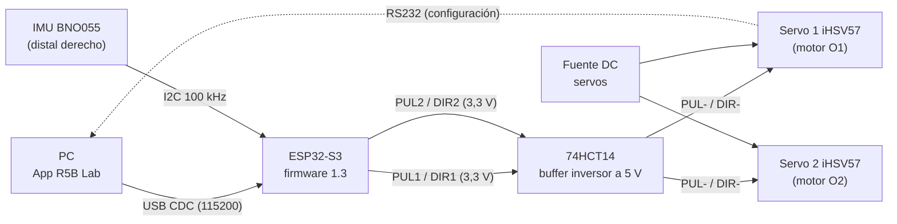

# 02 · Hardware

## Diagrama general

## Componentes

| Componente | Modelo | Cant. | Función |
|---|---|---|---|
| Servomotor AC integrado | JMC **iHSV57-30-18-36** | 2 | Actuadores de los proximales (transmisión directa) |
| Microcontrolador | ESP32-S3 (Arduino-ESP32 core) | 1 | Trayectoria y pulsos, lectura de la IMU, EKF, seguridad, telemetría |
| Buffer | 74HCT14 (hex inversor Schmitt) | 1 | Adapta 3,3 V → 5 V, invierte el pulso y limpia flancos |
| IMU | **BNO055** (Bosch) | 1 | Giro y aceleración del distal derecho a 100 Hz para el EKF |
| Eje Z | Motorreductor N20 con encoder (CH-N20-3) + husillo T8 | 1 | Subir y bajar la garra (aún sin control desde la ESP32) |
| Garra | Servo MG90S + dedos de TPU | 1 | Pick and place (aún sin control desde la ESP32) |
| Rodamientos | 6905-2RS (efector), 608 (husillo Z) | — | Articulación del efector y eje Z |
| Fuente de los servos | *pendiente de documentar* | 1 | |

Ya no se usan: la **MPU6050 (módulo GY-521)**, que sirvió solo para una primera caracterización en octubre y se reemplazó por la BNO055; los **AS5600**, descartados; y la **ventosa con bomba de vacío**, reemplazada por la garra.

## Servomotores JMC iHSV57-30-18-36

Servo AC integrado (motor + driver + encoder en un mismo cuerpo). Se comanda como un paso a paso (pulso + dirección), pero cierra internamente sus lazos de posición (P), velocidad (PI) y corriente con su encoder. **Desde afuera no hay acceso a par, corriente ni encoder**: solo se le mandan pulsos.

| Dato | Valor |
|---|---|
| Brida | NEMA 23 (57 mm); eje Ø8 mm con cara plana |
| Potencia / velocidad nominal | 180 W / 3000 rpm |
| Par nominal / pico | ~0,6 N·m / ~1,8 N·m |
| Tensión nominal | 36 V DC |
| Encoder | 1000 líneas → 4000 cuentas/rev (resolución de 0,09°) |
| Inercia del rotor | 0,3 kg·cm² (P00-04) |
| Resolución de comando | **8000 pulsos/rev** (engrane electrónico P03-10/P03-11 = 1/2); debe coincidir con `STEPS_PER_REV` en `kinematics_5bar.h` |
| Configuración | Por RS232 con el software JMC (`JmcServoPcControl` 1.7.6). Los dos drivers tienen exactamente los mismos parámetros |

### Sintonía congelada (13 nov 2026)

Es la que se usa en todas las campañas de los papers. **No se vuelve a tocar** hasta cerrarlas.

| Parámetro | Valor congelado | Valor de fábrica |
|---|---|---|
| P01-02 ajuste automático | 0 (apagado) | 1 |
| P01-04 relación de inercia | 6 | 3 |
| P02-00 ganancia del lazo de posición (Kp) | 15 s⁻¹ | 48 |
| P02-03 prealimentación de velocidad | 50 % | 30 % |
| P02-10 ganancia del lazo de velocidad | 50 Hz | 27 |
| P02-11 constante integral de velocidad | 300 ms | 10 ms |
| P08-25 compensación de perturbación | 0 % | 0 |
| P02-30 cambio de ganancias | 0 | — |

- Subir P01-04 a 50 o 100 produce un chillido audible (~145 Hz por el audio del video) e inestabilidad. No repetir esos ajustes.
- La re-sintonía no reduce la oscilación de 2–4 Hz después de las paradas: el margen del driver se agota por la relación de inercia (105–360).

Manuales: ver [hardware/datasheets](../hardware/datasheets/README.md).

> ⚠️ **Frenado regenerativo.** Al desacelerar, el servo devuelve energía a la fuente. Se ha reportado que esos picos de tensión destruyen el driver y la fuente si no hay protección. Como el robot hace movimientos de ida y vuelta, conviene poner un diodo/capacitor o una resistencia de frenado en la alimentación de los servos.
>
> El baudrate RS232 real de fábrica reportado por otros usuarios es 57600 bps (no 9600 como dice el manual). Verificarlo antes de configurar.

## Cableado de señales (ánodo común)

Según el manual del iHSV57 (cap. 6.1), conexión en ánodo común:

| Señal servo | Conexión |
|---|---|
| PUL+, DIR+ (ambos servos) | +5 V |
| PUL−, DIR− servo 1 | salidas del 74HCT14 ← GPIO 4 / GPIO 5 |
| PUL−, DIR− servo 2 | salidas del 74HCT14 ← GPIO 15 / GPIO 16 |
| GND servos | GND ESP32 (unir las tierras en un solo punto) |

**Por qué el 74HCT14:** con ánodo común el optoacoplador del servo se enciende cuando PUL− está en bajo, así que el pulso debe ser activo-bajo. FastAccelStepper genera pulsos activo-alto a 3,3 V. El 74HCT14 sube el nivel a 5 V, invierte el pulso (LEDs del opto apagados en reposo) y da flancos limpios (Schmitt). La inversión también afecta a DIR: si un motor gira al revés se cambia `DIR_SIGN1/2` en el firmware.

Por ahora **no se usa la señal ENABLE** (solo PUL/DIR).

## Pines de la ESP32-S3

| GPIO | Uso | Archivo |
|---|---|---|
| 4 | PUL eje 1 | `robot_5bar_esp32.ino` |
| 5 | DIR eje 1 | `robot_5bar_esp32.ino` |
| 15 | PUL eje 2 | `robot_5bar_esp32.ino` |
| 16 | DIR eje 2 | `robot_5bar_esp32.ino` |
| 8 | SDA BNO055 | `imu_bno055.h` |
| 9 | SCL BNO055 | `imu_bno055.h` |
| 19, 20 | USB nativo (no usar) | |

Evitar los pines de arranque (0, 3, 45, 46), 43 y 44 (UART0) y 35–37 si la placa tiene PSRAM octal (N8R8 / N16R8).

## IMU BNO055

| Dato | Valor |
|---|---|
| Conexión | VIN → 3V3, GND → GND, SDA → GPIO 8, SCL → GPIO 9; PS0/PS1 a GND (I²C); INT y RST sin conectar |
| Dirección I²C | **0x29** en el módulo del equipo (el firmware busca 0x28 y 0x29) |
| Reloj | Oscilador **interno** (el módulo no arranca con cristal externo) |
| Bus | 100 kHz: más tolerante al ruido de los servos que 400 kHz |
| Modo | **IMU** (acelerómetro + giroscopio, fusión interna, sin magnetómetro). El magnetómetro se perturba cerca de los motores |
| Frecuencia | 100 Hz, leída en una tarea propia en el núcleo 0 |
| Resolución | giroscopio 1/16 °/s; acelerómetro 0,01 m/s² |
| Calibración | giroscopio y acelerómetro en 3, guardada en la flash de la ESP32 y cargada en cada arranque. No usar *Erase All Flash* |
| Convención | giro antihorario visto desde arriba → gz positivo (igual que los ángulos del robot). El rumbo de la fusión crece en sentido horario: se usa −rumbo |
| Escala efectiva del giroscopio | k = 1,031 (calibración cinemática) |
| Ruido en reposo | gz: 0,10 °/s de desviación estándar, 0,0135 °/s/√Hz (igual a la hoja de datos) |

**Ruido eléctrico:** con los servos energizados aparecían lecturas I²C corruptas (0,6 %, bytes en 0xFF). El firmware las detecta y repite la lectura anterior, y los análisis las descartan. Ayuda trenzar SDA y SCL cada uno con un GND, alejar el cable de los de potencia y unir las tierras en un punto.

Guía y resultados de la caracterización: [imu/etapa0_bno055](../imu/etapa0_bno055/LEEME.md).

## Por documentar

- [ ] Fuente de alimentación de los servos (tensión, corriente) y protección contra sobretensión
- [ ] Esquemático o foto del cableado real y del buffer
- [ ] Pines del N20, su encoder y el MG90S cuando se integren a la ESP32
