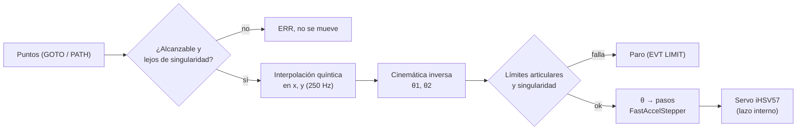
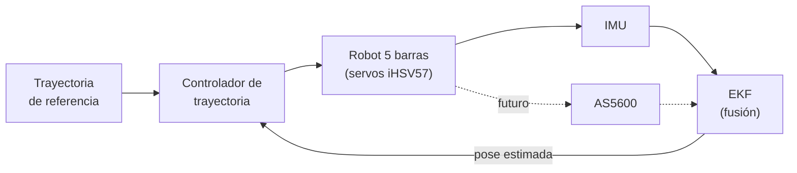

# 03 · Control

## Resumen

| Nivel | Dónde corre | Qué hace | Estado |
|---|---|---|---|
| Lazo de posición / velocidad / corriente de cada motor | Driver interno del iHSV57 | Sigue los pulsos recibidos usando su encoder | Funcionando (de fábrica) |
| Generación de trayectoria cartesiana + cinemática inversa | ESP32-S3 | Interpola el camino, calcula θ1, θ2 a 250 Hz y genera los pulsos | Funcionando |
| Seguridad | ESP32-S3 | Alcance, singularidad, límites articulares, paro | Funcionando |
| Estimación con EKF + IMU como realimentación activa | ESP32 / PC | Corrige la trayectoria con la pose estimada | Planeado (Técnicas de Control) |
| Control servo-visual con cámara + IMU | PC + ESP32 | Pick and place guiado por visión | Planeado (PAE 2027-1) |

Hoy, a nivel del robot completo, el control es **en lazo abierto**: la ESP32 no mide la posición real de los eslabones; confía en que cada servo sigue sus pulsos. Por eso el cero y el modo de ensamblaje tienen que ser correctos.

## Cinemática

Convención: O1 = (0, 0), O2 = (D, 0); θ1 y θ2 medidos desde el eje x, positivos en sentido antihorario.

### Inversa

Para cada cadena, con r la distancia de la base al punto P = (x, y):

- Cadena izquierda: r₁ = √(x² + y²), φ₁ = atan2(y, x), β₁ = acos[(r₁² + L1² − L2²) / (2 r₁ L1)]
- Cadena derecha: r₂ = √((x − D)² + y²), φ₂ = atan2(y, x − D), β₂ = acos[(r₂² + L4² − L3²) / (2 r₂ L4)]
- θ₁ = φ₁ + sgn₁·β₁, θ₂ = φ₂ + sgn₂·β₂ (el signo define el modo de ensamblaje, ver [01-fabricacion.md](01-fabricacion.md#modos-de-ensamblaje))

El punto es alcanzable si |Lprox − Ldist| ≤ rᵢ ≤ Lprox + Ldist para ambas cadenas.

### Directa

Se calculan los codos A = (L1 cos θ₁, L1 sin θ₁) y B = (D + L4 cos θ₂, L4 sin θ₂), y P es la intersección de las circunferencias de radio L2 centrada en A y L3 centrada en B. De las dos soluciones se toma la que corresponde al modo de ensamblaje.

### Jacobiano y singularidades

Con αᵢ el ángulo de cada eslabón distal:

- J_P = [cos α₁ sin α₁; cos α₂ sin α₂]
- J_θ = diag(L1 sin(α₁ − θ₁), L4 sin(α₂ − θ₂))
- J_P · ṗ = J_θ · θ̇ → ṗ = J_P⁻¹ J_θ θ̇

| Tipo | Condición | Significado |
|---|---|---|
| Paralela (tipo 2) | det J_P ∝ sin(α₁ − α₂) = 0 | Los distales quedan alineados; el robot pierde rigidez |
| Serial (tipo 1) | det J_θ = 0 | Un proximal y su distal quedan alineados (borde del espacio de trabajo) |

**Guarda en el firmware:** se rechaza cualquier punto con |sin(α₁ − α₂)| < 0,15 (`SIN_MIN`).

En MATLAB, `inverse_jacobian.m` calcula θ̇ = J⁻¹ ṗ con varios métodos (`inverse`, `pinv`, `damped`, `damped_adaptive`) para no explotar cerca de singularidades.

## Generación de trayectoria

Cada trayectoria es una lista de puntos; entre cada par de puntos se recorre una **recta** con perfil **quíntico**:

s(τ) = 10τ³ − 15τ⁴ + 6τ⁵, τ = t/T ∈ [0, 1]

Velocidad y aceleración son cero al inicio y al final de cada segmento. La duración T del segmento se escoge para respetar la velocidad y la aceleración máximas del efector:

- pico de velocidad = 1,875·d/T → T_v = 1,875·d / Vmax
- pico de aceleración = 5,7735·d/T² → T_a = √(5,7735·d / Amax)
- T = máx(T_v, T_a)

Valores por defecto en el robot: Vmax = 0,10 m/s, Amax = 0,20 m/s² (se cambian con `SETV`).

## Esquema actual en la ESP32

- Frecuencia de actualización del setpoint: 250 Hz (`TICK_US = 4000`).
- Conversión: pasos = θ · 8000 / 2π (con el signo de dirección de cada eje).
- Límites articulares blandos: θ1 ∈ [10°, 250°], θ2 ∈ [−70°, 250°] (ajustar a los topes reales).

## Simulación en MATLAB

`simulacion/matlab/main.m` define el robot (geometría, masas, inercias, fricción y un modelo de motor), genera una trayectoria quíntica multipunto (triángulo) con Vmax = 0,2 m/s y Amax = 0,25 m/s² a 100 Hz, calcula las velocidades articulares con el Jacobiano inverso amortiguado y anima el robot con gráficas de θ1, θ2, |v| y |a|.

## Esquema planeado: EKF + IMU como realimentación activa (Técnicas de Control)

Decisión del equipo: no se compara contra un PD/CTC clásico aparte. Se compara el **mismo esquema de control con y sin la retroalimentación activa de la IMU**.

Pasos:
1. **Etapa 0 (en curso):** caracterizar la IMU en reposo (sesgos, ruido, Allan, deriva térmica), con servos apagados y encendidos → matriz R y sesgos iniciales del EKF. Ver [imu/etapa0](../imu/etapa0/README.md).
2. **Etapa 1:** registrar la IMU mientras el robot hace trayectorias y compararla con lo que predice la cinemática.
3. Diseñar el EKF e integrarlo al lazo.
4. Validar con métricas de error de trayectoria (con IMU activa vs. sin IMU activa).

Por ahora no hay encoders externos: se empieza solo con la IMU y se integran los AS5600 cuando lleguen.

## Asignatura Robótica

El enfoque en Robótica es la cinemática del robot y el gripper (no el EKF).

## PAE 2027-1

Control servo-visual (visual servoing) con fusión cámara + IMU para pick and place. Ver [06-investigacion.md](06-investigacion.md).
