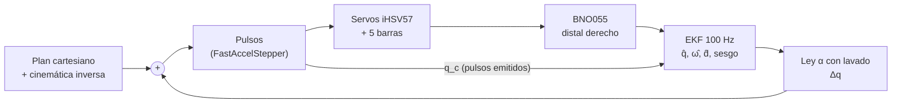

# 03 · Control

## Resumen

| Nivel | Dónde corre | Qué hace | Estado |
|---|---|---|---|
| Lazos de posición (P), velocidad (PI) y corriente de cada motor | Driver interno del iHSV57 | Sigue los pulsos recibidos con su encoder | Funcionando, sintonía congelada (13 nov) |
| Trayectoria cartesiana + cinemática inversa | ESP32-S3 | Trayectoria continua por trazos, IK y streaming de pulsos cada 4 ms | Funcionando |
| Seguridad | ESP32-S3 | Alcance, singularidad, límites articulares, cambio de modo verificado, paro | Funcionando |
| Estimación con EKF + IMU | ESP32-S3 (tarea de la IMU, 100 Hz) | Estima ángulos, velocidades y pares de perturbación de los dos brazos | Funcionando (firmware 1.3) |
| Corrección con IMU (realimentación activa) | ESP32-S3 | Suma Δq a los pulsos: inyección de amortiguamiento con filtro de lavado | Funcionando; arranca apagada (Paper 2) |
| Prealimentación por modelo | ESP32-S3 | Adelanta el retardo y el par de inercia en la referencia | Firmware 1.4, aún no probado en el robot |
| Control servo-visual con cámara + IMU | PC + ESP32 | Pick and place guiado por visión | Planeado (PAE 2027-1) |

Sin la corrección con IMU, el control del robot completo es **en lazo abierto**: la ESP32 no mide la posición real de los eslabones y confía en que cada servo sigue sus pulsos. Por eso el cero y el modo de ensamblaje tienen que ser correctos.

## Cinemática

Convención: O1 = (0, 0), O2 = (D, 0); θ1 y θ2 medidos desde el eje x, positivos en sentido antihorario. Geometría vigente: L1 = L4 = 0,12 m, L2 = L3 = 0,18 m, D = 0,15 m.

### Inversa

- Cadena izquierda: r₁ = √(x² + y²), φ₁ = atan2(y, x), β₁ = acos[(r₁² + L1² − L2²) / (2 r₁ L1)]
- Cadena derecha: r₂ = √((x − D)² + y²), φ₂ = atan2(y, x − D), β₂ = acos[(r₂² + L4² − L3²) / (2 r₂ L4)]
- θ₁ = φ₁ + sgn₁·β₁, θ₂ = φ₂ + sgn₂·β₂ (el signo define el modo de ensamblaje, ver [01-fabricacion.md](01-fabricacion.md#modos-de-ensamblaje))

El punto es alcanzable si |Lprox − Ldist| ≤ rᵢ ≤ Lprox + Ldist para ambas cadenas.

### Directa

Se calculan los codos A = (L1 cos θ₁, L1 sin θ₁) y B = (D + L4 cos θ₂, L4 sin θ₂), y P es la intersección de las circunferencias de radio L2 centrada en A y L3 centrada en B, en la rama que corresponde al modo de ensamblaje.

### Jacobiano y singularidades

Con αᵢ el ángulo de cada eslabón distal:

- J_P = [cos α₁ sin α₁; cos α₂ sin α₂]
- J_θ = diag(L1 sin(α₁ − θ₁), L4 sin(α₂ − θ₂))
- J_P · ṗ = J_θ · θ̇ → ṗ = J_P⁻¹ J_θ θ̇

| Tipo | Condición | Significado |
|---|---|---|
| Paralela (tipo 2) | det J_P ∝ sin(α₁ − α₂) = 0 | Los distales quedan alineados; el robot pierde rigidez |
| Serial (tipo 1) | det J_θ = 0 | Un proximal y su distal quedan alineados (borde del espacio de trabajo) |

**Guardas en el firmware:** se rechaza cualquier punto con |sin(α₁ − α₂)| < 0,15 (`SIN_MIN`); el cambio de modo exige > 0,05 en todo el recorrido. Límites articulares blandos: θ1, θ2 ∈ [−170°, 350°], calculados para cubrir la zona y > 0 en los modos 1, 3 y 4.

## Generación de trayectoria (firmware 1.x)

- **Trayectoria continua:** una figura se divide en *trazos* que se recorren sin detenerse. El robot solo frena en las **esquinas** (cambios de dirección > 30°, `CORNER_DEG`). Un círculo es un solo trazo a velocidad constante; un cuadrado son cuatro.
- **Perfil de cada trazo:** rampa de aceleración suave (velocidad quíntica) hasta la velocidad de crucero, crucero y rampa de frenado. La rampa dura Ta = 1,875·v/Amax; si el trazo es corto, se baja la velocidad de crucero.
- **Streaming:** cada 4 ms (250 Hz) se comanda el punto donde debe estar el efector 12 ms más adelante (`LOOKAHEAD_TICKS = 3`), con la velocidad de pasos justa para llegar en ese tiempo. El tren de pulsos es continuo y el motor no frena entre ticks.
- **Conversión:** pasos = θ · 8000 / 2π, con el signo de dirección de cada eje.
- **Velocidad y aceleración:** se fijan con `SETV`; arrancan en 0,10 m/s y 0,20 m/s² y se limitan a 0,50 m/s y 3 m/s². Las pruebas usan 100/1000 y 200/2000 (mm/s, mm/s²).
- El generador reproduce la figura con 0,04–0,08 mm RMS a 100 mm/s y 0,3–0,4 mm RMS a 200 mm/s; el error del robot viene de la dinámica, no del plan.

## Dinámica identificada (Paper 1)

Cada servo se comporta como un resorte-amortiguador con retardo frente a la inercia que ve en cada postura:

M(q)·q̈ + C(q, q̇)·q̇ = K·[q_c(t − τ) − q] + B·[ff·q̇_c(t − τ) − q̇] + d

- M(q) sale de las masas medidas (proximal 115 g, distal 170 g, efector 334 g) y la inercia del rotor.
- Identificado sobre trayectorias (ff fijo en 0,5, el valor del driver, porque no es identificable): K₁ = 1,29 N·m/rad, K₂ = 1,06 N·m/rad, B₁ = 0,032 N·m·s/rad, B₂ = 0,055 N·m·s/rad, τ = 25,7 ± 4,6 ms.
- En pruebas no usadas para el ajuste, el modelo con M(q) explica el 76 % del giro del distal (frente a 71 % con inercia constante) y deja 2,75 mm RMS de error de posición en video.
- **Frecuencia natural de 1,6 a 3,7 Hz**, según la postura y la amplitud: baja hasta 49 % cuando el movimiento crece (ablandamiento). El amortiguamiento va de 0,11 a 0,35.
- Con los servos apagados y los brazos bloqueados la oscilación desaparece: viene del lazo del servo actuando contra una inercia reflejada 105–360 veces la del rotor, no de un modo estructural de los eslabones.

Detalle completo, datos y scripts en [`paper1-tecnologicas/`](../paper1-tecnologicas/README.md).

## Esquema con EKF + IMU (firmware 1.3, Paper 2)

Se compara el **mismo esquema con y sin la corrección de la IMU**, en la misma sesión (no se implementa un PD/CTC clásico aparte).

- **EKF** en la tarea de la IMU (100 Hz, núcleo 0): estima los ángulos, las velocidades y los pares de perturbación de los dos brazos, más el sesgo del giroscopio, con el modelo identificado y los pulsos emitidos como entrada.
- **Ley de corrección (inyección de amortiguamiento):** Δq = −K⁻¹·D·zona(ω̂ − q̇_plan), con D = 2α√(K·M). Por defecto α = 0,3, zona muerta de 1 °/s, recorte de ±1° y cambio máximo de 0,3° cada 10 ms, más un **filtro de lavado** de 1 s que impide sostener una corrección constante (un sesgo del acelerómetro no deja error en reposo).
- **Modos:** Apagada (igual que el firmware 1.x), **Sombra** (el EKF corre y se registra, no se aplica) y **Activa** (Δq se suma a los pulsos). Se pasa sola a Sombra (`EVT CTL_OFF`) si la IMU deja de leer, da lecturas inválidas, el giroscopio diverge del EKF o el EKF da un valor inválido.
- **LQR con retardo:** disponible pero experimental. Con una sola IMU en un distal una dirección es poco observable, y realimentar la posición estimada deja 1–2 mm de error en reposo.

**Primera sesión con/sin IMU (15 nov 2026, antes del mantenimiento):** a 200/2000 la corrección activa bajó el error de contorno 35–38 %, el sobrepaso al parar 55–68 % y el tiempo hasta ±1 mm ~70 % en el cuadrado. En pick and place redujo el sobrepaso al tomar ~30 % y el tiempo hasta ±1 mm ~66 %. La repetibilidad empeoró por una deriva que resultó mecánica (acoples), corregida en el mantenimiento del 22 nov. El bloque definitivo del Paper 2 se repite después del mantenimiento.

## Prealimentación por modelo (firmware 1.4, en desarrollo)

q_c(t) = q_plan(t + τ) + K⁻¹·[M(q)·q̈ + C(q, q̇)·q̇ + B·(1 − ff)·q̇]

Adelanta el retardo del servo y manda por adelantado el par que hará falta para acelerar la inercia de cada postura. Recorte de ±10° por motor. Con la prealimentación apagada los pulsos son idénticos a los de la 1.3. En simulación con el firmware real en el lazo baja el contorno del cuadrado 200/2000 de 5,8 a 1,5 mm; en el robot real la mejora será menor porque el modelo no explica todo el movimiento.

## Simulación en MATLAB

`simulacion/matlab/main.m` define el robot (geometría v3, masas medidas, inercias, fricción y un modelo de motor), genera una trayectoria quíntica multipunto (triángulo) con Vmax = 0,2 m/s y Amax = 0,25 m/s² a 100 Hz, calcula las velocidades articulares con el Jacobiano inverso amortiguado y anima el robot.

## Por asignatura

- **Técnicas de Control:** EKF + IMU como realimentación activa en el seguimiento de trayectorias, aplicado a pick and place (Paper 2).
- **Robótica:** cinemática y dinámica del 5 barras, y el gripper.
- **PAE 2027-1:** control servo-visual con fusión cámara + IMU para pick and place. Ver [06-investigacion.md](06-investigacion.md).
