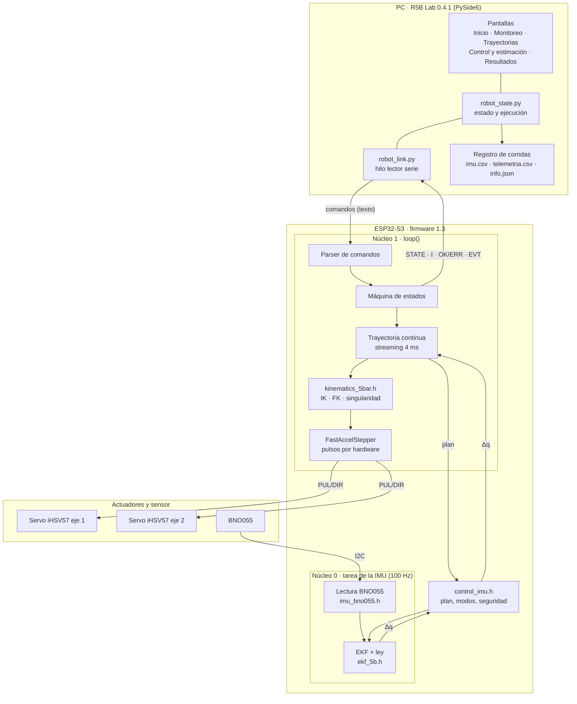
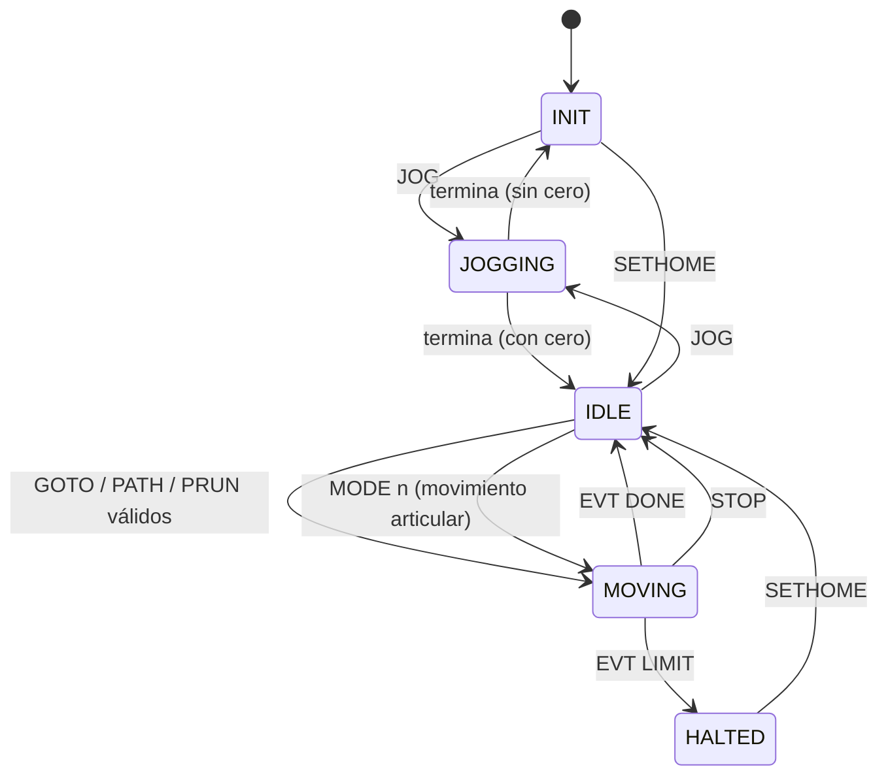
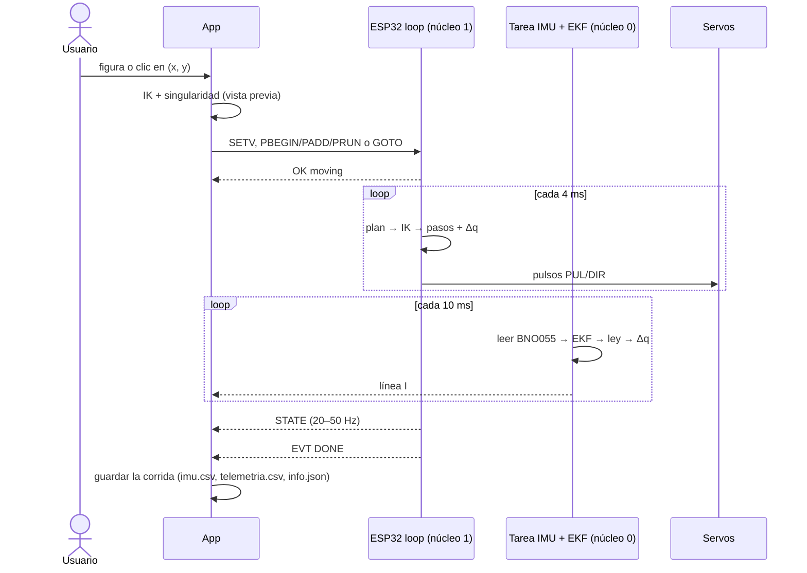
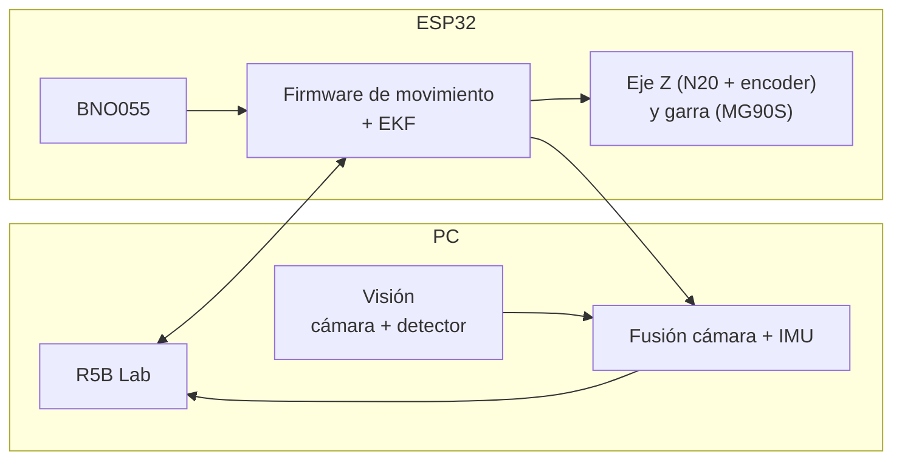

# 05 · Arquitectura de software

## Vista general

El sistema tiene tres capas. El PC decide **qué** hacer y registra todo; la ESP32 decide **cómo** moverse con seguridad, lee la IMU y estima el estado; cada servo se encarga de **seguir** sus pulsos.



**Decisiones de diseño:**
- **Una sola fuente de verdad para la geometría:** `kinematics_5bar.h`. La app la pide con `GEOM` al conectar.
- **La trayectoria se genera en la ESP32, no en el PC.** El PC manda solo los puntos; el movimiento no depende de la latencia del USB ni de Windows.
- **El EKF corre en la ESP32**, en la misma tarea que lee la IMU, para que la corrección llegue a los pulsos con el menor retardo. El EKF más la ley tardan ~1 ms, muy por debajo de los 10 ms de la muestra.
- **La corrección actúa sobre la referencia de pulsos**, porque el driver no da acceso al par. El driver conserva sus lazos internos.
- **Arranque seguro:** la corrección arranca Apagada y se pasa sola a Sombra ante cualquier falla de la IMU o del EKF.
- **Validación en los dos lados.** La app revisa alcance y singularidad para dar aviso inmediato, y el firmware vuelve a revisar todo antes y durante el movimiento.
- **Protocolo de texto por líneas.** Se puede probar desde cualquier monitor serie, sin la app.
- **Cada corrida queda registrada** con la IMU, los ángulos de los motores del mismo instante y la configuración. Los scripts de análisis leen esos archivos directamente.

## Protocolo serie

Texto ASCII, una línea por mensaje terminada en `\n`, 115200 bps (USB CDC nativo). Unidades: metros y grados.

**PC → ESP32**

| Comando | Respuesta | Descripción |
|---|---|---|
| `PING` | `OK PONG` | Prueba de conexión |
| `GEOM` | `GEOM L1 L2 L3 L4 D` | Geometría del firmware |
| `STATUS` | `STATE …` | Pide la telemetría al instante |
| `JOG <1\|2> <grados>` | `OK jog …` | Mueve un eje de forma relativa y lenta (se permite sin cero) |
| `SETHOME [th1 th2]` | `OK home set …` + `EVT HOMED` + `MODE n` | Fija el cero con el utillaje puesto; sin argumentos usa 90°/90° |
| `SETV <vmax> <amax>` | `OK setv …` | Velocidad (m/s) y aceleración (m/s²) máximas del efector |
| `GOTO <x> <y>` | `OK moving …` … `EVT DONE` | Va en línea recta desde la posición actual |
| `PATH <n> x1 y1 … xn yn` | `OK moving …` … `EVT DONE` | Recorre n puntos (2 a 130) como trazos continuos; para cerrar la figura se repite el primero |
| `PBEGIN n` / `PADD x y …` / `PRUN` | `OK …` por línea | Igual que `PATH`, cargando la figura en líneas cortas con confirmación (lo usa la app) |
| `MODE` / `MODE <n>` | `MODE n` | Consulta o cambia el modo de ensamblaje (con cero, mueve los brazos manteniendo el efector) |
| `IMU` / `IMU 1` / `IMU 0` | `IMU ok …` / líneas `I` | Estado de la BNO055; activa o detiene el envío de muestras a 100 Hz |
| `CTL` | `CTL modo=… ley=… alfa=… …` | Estado de la corrección y tiempo de cálculo del EKF |
| `CTL MODO 0\|1\|2` | `OK ctl …` | Corrección apagada / sombra / activa |
| `CTL LEY ALFA\|LQR`, `CTL ALFA v`, `CTL ZONA °/s`, `CTL DMAX °`, `CTL LAVADO s`, `CTL GRAV …`, `CTL RESET` | `OK ctl …` | Parámetros de la ley y del EKF |
| `STOP` | `OK stopped` | Paro inmediato, descarta la trayectoria |

**ESP32 → PC**

| Mensaje | Significado |
|---|---|
| `OK <texto>` / `ERR <texto>` | Respuesta a un comando |
| `EVT HOMED` | Cero fijado |
| `EVT DONE` | Trayectoria terminada |
| `EVT LIMIT` | Paro por límite articular o singularidad durante el movimiento |
| `EVT CTL_OFF <motivo>` | La corrección se pasó sola a Sombra (`SIN_LECTURA`, `IMU_INVALIDA`, `INNOVACION`, `EKF`) |
| `MODE <n>` | Modo de ensamblaje activo |
| `STATE <estado> <x> <y> <θ1> <θ2> <moviendo>` | Telemetría a 50 Hz (20 Hz mientras se envía la IMU) |
| `I t q1 q2 ax ay az gx gy gz rumbo roll pitch cal …` | Muestra de la IMU a 100 Hz con los ángulos de los motores del mismo instante; la 1.3 agrega 10 campos del EKF y la ley (q̂, ω̂, d̂, Δq, innovación, estado) |

Ejemplo de sesión:

```
>> PING
<< OK PONG
>> SETHOME 90 90
<< OK home set th1=90.00 th2=90.00 -> x=0.0750 y=0.2836
<< EVT HOMED
<< MODE 1
>> GOTO 0.075 0.20
<< OK moving …
<< EVT DONE
<< STATE IDLE 0.0750 0.2000 126.84 53.16 0
```

(Valores calculados con la geometría v3. Las líneas `STATE` llegan durante todo el movimiento; aquí se muestra solo la última.)

## Máquina de estados del firmware



`GOTO` y `PATH` exigen haber fijado el cero y que los brazos estén en el modo activo; si no, responden `ERR`. La corrección con IMU solo actúa en movimiento cartesiano y en reposo con el cero fijado; no actúa en JOG, cambio de modo, HALTED ni sin cero, y el EKF se reinicia después de STOP, JOG o SETHOME.

## Flujo de un movimiento con la IMU



## Arquitectura objetivo



- Integrar el eje Z (lazo de posición con el contador PCNT y cero por tope) y la garra al firmware, con comandos propios.
- Pick and place con carga real, que es donde la corrección con IMU debería aportar más.
- Firmware 2.0 con pulsos sincronizados (versión de revista) y, a futuro, un generador de pulsos más potente.
- Visión y fusión cámara + IMU para la PAE.
