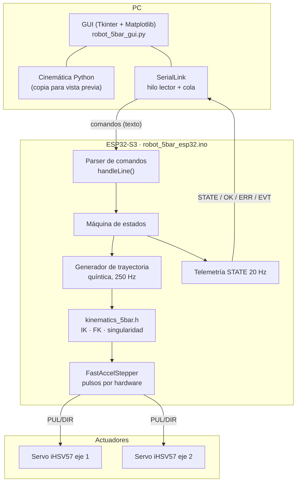
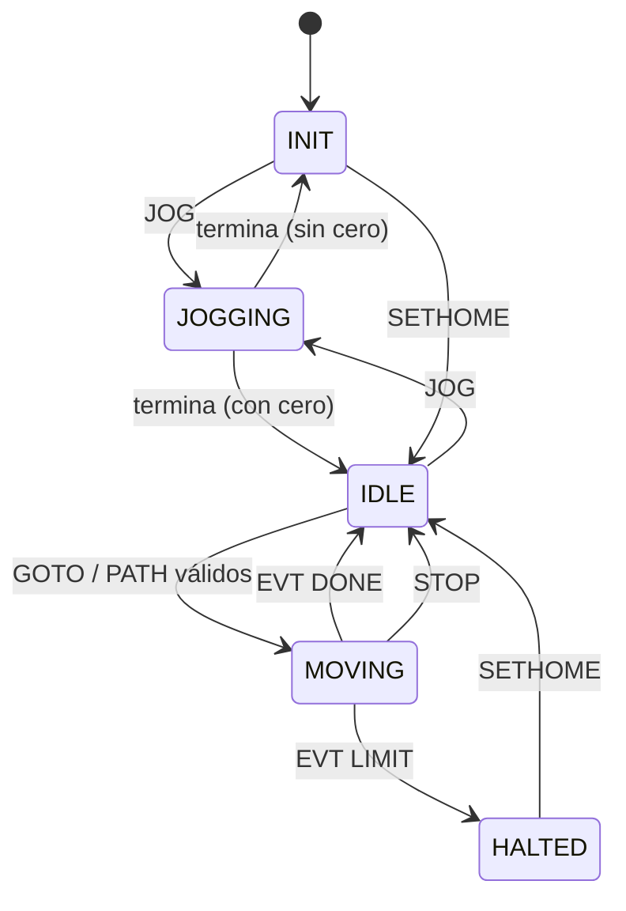
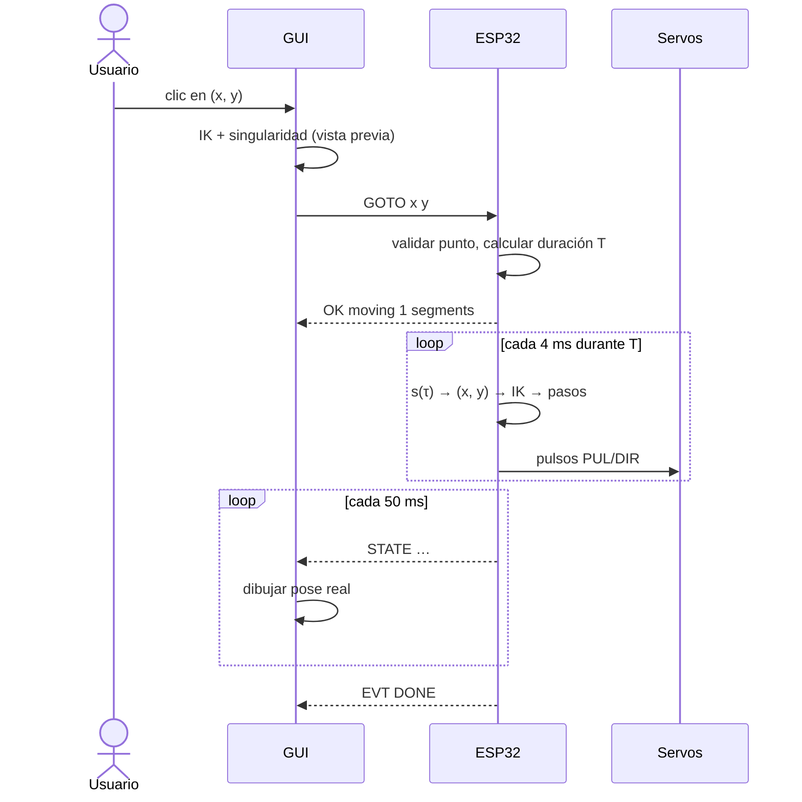
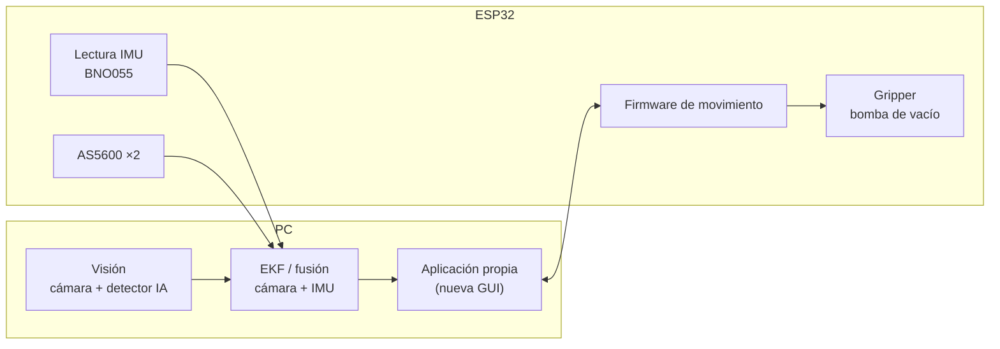

# 05 · Arquitectura de software

## Vista general

El sistema tiene tres capas. El PC decide **qué** hacer, la ESP32 decide **cómo** moverse con seguridad, y cada servo se encarga de **seguir** sus pulsos.



**Decisiones de diseño:**
- **Una sola fuente de verdad para la geometría:** `kinematics_5bar.h`. La GUI la pide con `GEOM` al conectar, así no hay que editar dos archivos.
- **La trayectoria se interpola en la ESP32, no en el PC.** El PC manda solo los puntos de paso; así el movimiento no depende de la latencia del USB ni de Windows.
- **Validación en los dos lados.** La GUI revisa alcance y singularidad para dar aviso inmediato, y el firmware vuelve a revisar todo antes y durante el movimiento.
- **Protocolo de texto por líneas.** Se puede probar desde cualquier monitor serie, sin la GUI.
- **GUI sin bloqueos.** Un hilo lee el puerto y deja las líneas en una cola; la interfaz la revisa cada 50 ms con `root.after`.

## Protocolo serie

Texto ASCII, una línea por mensaje terminada en `\n`, 115200 bps. Unidades: metros y grados.

**PC → ESP32**

| Comando | Respuesta | Descripción |
|---|---|---|
| `PING` | `OK PONG` | Prueba de conexión |
| `GEOM` | `GEOM L1 L2 L3 L4 D` | Geometría del firmware |
| `STATUS` | `STATE …` | Pide la telemetría al instante |
| `JOG <1\|2> <grados>` | `OK jog …` | Mueve un eje de forma relativa y lenta (se permite sin cero) |
| `SETHOME [th1 th2]` | `OK home set …` + `EVT HOMED` | Fija el cero con el utillaje puesto; sin argumentos usa 90°/90° |
| `SETV <vmax> <amax>` | `OK setv …` | Velocidad (m/s) y aceleración (m/s²) máximas del efector |
| `GOTO <x> <y>` | `OK moving 1 segments` … `EVT DONE` | Va en línea recta desde la posición actual |
| `PATH <n> x1 y1 … xn yn` | `OK moving n-1 segments` … `EVT DONE` | Recorre n puntos (2 a 130); para cerrar la figura se repite el primero |
| `STOP` | `OK stopped` | Paro inmediato, descarta la trayectoria |

**ESP32 → PC**

| Mensaje | Significado |
|---|---|
| `OK <texto>` / `ERR <texto>` | Respuesta a un comando |
| `EVT HOMED` | Cero fijado |
| `EVT DONE` | Trayectoria terminada |
| `EVT LIMIT` | Paro por límite articular o singularidad durante el movimiento |
| `STATE <estado> <x> <y> <θ1> <θ2> <moviendo>` | Telemetría cada 50 ms |

Ejemplo de sesión:

```
>> PING
<< OK PONG
>> SETHOME 90 90
<< OK home set th1=90.00 th2=90.00 -> x=0.0775 y=0.2357
<< EVT HOMED
>> GOTO 0.08 0.18
<< OK moving 1 segments
<< EVT DONE
<< STATE IDLE 0.0800 0.1800 122.33 170.04 0
```

(Valores calculados con la geometría que tiene hoy el firmware. Las líneas `STATE` llegan cada 50 ms durante todo el movimiento; aquí se muestra solo la última.)

## Máquina de estados del firmware



`GOTO` y `PATH` exigen haber fijado el cero; si no, responden `ERR no homed`.

## Flujo de un movimiento



## Arquitectura objetivo

Lo que se va a agregar sobre la base actual:



- Integrar la lectura de la IMU (hoy en `imu/etapa0`, programa aparte) al firmware del robot.
- Agregar comandos para el gripper y para cambiar el modo de ensamblaje (`MODE n`).
- Definir dónde corre el EKF (ESP32 o PC) según la frecuencia necesaria.
- Separar la nueva GUI en capas: comunicación serie, modelo del robot (cinemática) y vistas.
